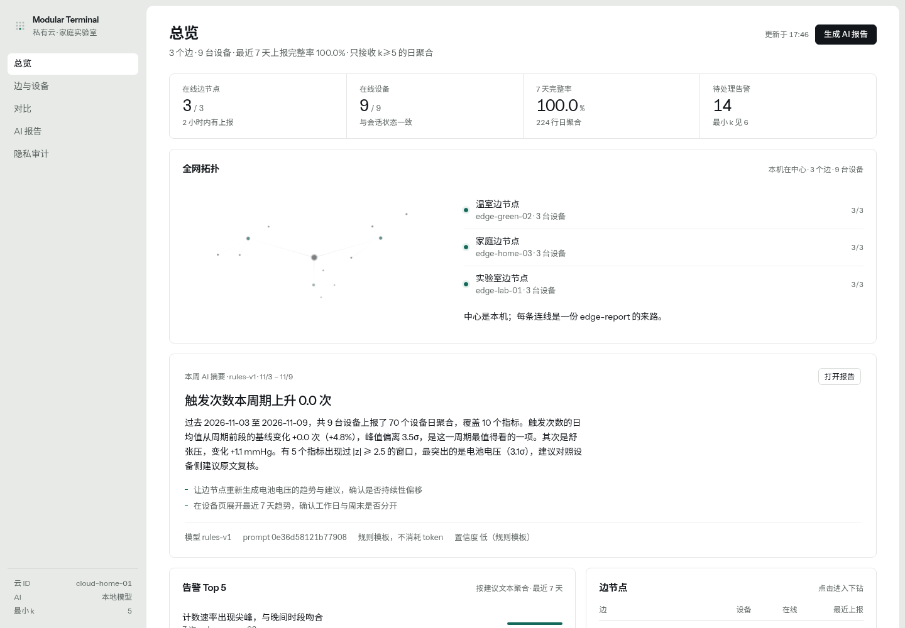

# Modular Terminal Cloud

端-边-云三层里的**云**：一台内网私有云。接收多个边节点上报的**日聚合**，
做跨边对比、AI 解读和隐私审计。方向相反——它不看单个用户，只看群体。



## 每个页面回答一个问题

| 页面 | 它回答的问题 | 关键内容 |
|---|---|---|
| 总览 | 这一周三条边都健康吗？ | WebGL 三维拓扑、在线数、设备日完整率、本周 AI 摘要、告警 Top5 |
| 边与设备 | 问题出在哪个边、哪台设备？ | 两级下钻：边 → 设备 → 日聚合趋势与明细 |
| 对比 | 谁跑得不一样？ | 同指标跨边指数（首日 = 100）、末日指数与变化 |
| AI 报告 | 机器怎么看这一周？ | 报告列表、findings、动作、模型与 token |
| 隐私审计 | 云到底拿到了什么？ | k 值分布、被抑制桶数、原始字段拦截、字段白名单、审计日志 |

## 快速开始

```bash
python3 -m pip install -r requirements.txt
./run.sh                       # 首次自动写入 3 个边 × 3 台设备 × 14 天演示数据
# http://127.0.0.1:8002
```

Docker（含可选 Ollama）：

```bash
cd docker && docker compose up -d --build
```

需要登录时（多机部署务必开）：

```bash
export CLOUD_ADMIN_PASSWORD='换成你的口令'
export CLOUD_ADMIN_TOTP='用 python3 -c "from cloud import auth;print(auth.secret_hint())" 生成'
```

## 数据流

```
边节点 ── POST /api/v1/ingest/edge-report ──▶ 云
              │  出现 user_id / subject / values 直接 422
              │  telemetry_daily 里任何一行 k<5 整份拒收
              ▼
        telemetry_daily   日聚合，唯一事实来源
        advice            建议文本
        word_freq         jieba 词频
        ai_reports        AI 解读（同输入 24 h 内复用）
        audit             每次摄取、登录与导出留痕
```

幂等键 `(edge_id, report_id)`；重复投递返回 `duplicate: true` 且不写库。

**指标字典来自数据，不是常量。** 边在日聚合里带上 `module_id / label / unit / table`，
云把它们一起入库；`/api/v1/meta` 由 `SELECT DISTINCT metric` 生成，
所以换模块之后前端下拉框、AI 措辞、对比页都会自动多出新指标。

## 已实现的功能

| 能力 | 说明 | 验证方式 |
|---|---|---|
| 摄取与幂等 | 原始字段 422、k<5 整份拒收、重复投递不写库 | `tests/test_ingest.py` |
| 管理员登录 | 口令 + TOTP（RFC 6238）+ HMAC 会话 cookie | `tests/test_auth.py`，含 RFC 测试向量 |
| AI 模式 B（默认） | 本地 Ollama，模型 `qwen3.5`；不可用退回规则模板 | `tests/test_ai.py` |
| AI 模式 A | 公有 API（`qwen3.5`），只发 k≥5 聚合，月度 token 预算熔断 | `tests/test_ai_public.py`，用本地假 API |
| 报告缓存 | 同 scope + 周期 + 输入摘要 24 h 内复用 | `tests/test_ai.py` |
| 词云 | jieba 分词 + 停用词 | `cloud/ai.py`、线上页面 |
| 动态指标字典 | 标签/单位跟着上报走，不写死 | `/api/v1/meta` |
| 保留期清理 | 日聚合 / 建议 / 词频 / 收件记录按天删 | `cloud/scheduler.py` |
| 每日全网报告 | 24 h 没有新报告就补一份 | 同上 |
| 隐私审计 | k 分布、抑制计数、拦截计数、字段白名单、导出留痕 | `tests/test_ingest.py` |
| 公网最小暴露 | 只有 `/ingest/edge-report` 与 `/health` 不要求登录 | `docker/Caddyfile` |

## 隐私边界

云端**没有**原始记录，也没有假名 subject：

| 云端有 | 云端没有 |
|---|---|
| 日聚合 `mean / slope / z / n_samples / k` | 逐条读数 |
| 建议文本 | 用户名、用户 ID |
| 抑制计数（只有数量） | 被抑制的内容 |
| 词频 | 设备序列号、地理位置 |

`k < 5` 的行在端侧已经不产生，边也不会转发；云侧再校验一次，出现即整份拒收。

## API

完整定义见 [`contracts/openapi/cloud.yaml`](contracts/openapi/cloud.yaml)，运行时 Swagger 在 `/api/docs`。

公网只应暴露两条：`/api/v1/ingest/edge-report` 与 `/api/v1/health`。
管理台与 Ollama 仅内网——`docker/Caddyfile` 就是这么配的，其余路径直接 404。

## 契约

| 契约 | 位置 | 谁拥有 |
|---|---|---|
| `orpi.edge.report.v1`（边→云） | `contracts/vendor/edge/edge-report@v1.json` | 边仓，本仓 vendor |
| `ai.report.v1`（云内） | `contracts/ai/report.v1.json` | **本仓** |

## 测试

```bash
python3 -m unittest discover -s tests -t . -v
```

**22 个用例**：摄取边界、审计口径、AI 契约与缓存、TOTP 与会话、
公有 API 的成功/失败/超额三条路径。

## 仍然没做的

| 方案里的东西 | 现状 |
|---|---|
| PostgreSQL + Redis + RQ | 用 SQLite + 进程内 asyncio 调度替代。表结构与 DDL 一一对应，换 Postgres 只需改 `store.py` 的占位符与连接；本机没有 PG 实例，未验证 |
| 边证书 mTLS 终止 | Caddy 的 TLS 已配好，应用侧用 Bearer token；接 client cert 只差 `tls { client_auth }` |
| 每日 pg_dump + 加密离线副本 | 只有 `scripts/backup.sh`（SQLite 在线备份，保留 14 天，可选 gpg 加密） |
| 多租户 | 明确不做（方案里也不在范围） |

演示数据由 `cloud/seed.py` 生成，**不是真实上报**；接真机前清掉 `data/`。

## 目录

```
cloud/         API、存储、AI、鉴权、调度、前端（含 WebGL 拓扑）
contracts/     ai 契约、示例、OpenAPI、vendor 副本
tests/         摄取 / AI / 鉴权
docker/        compose、Caddyfile
scripts/       vendor 契约同步、备份
docs/          截图
```
