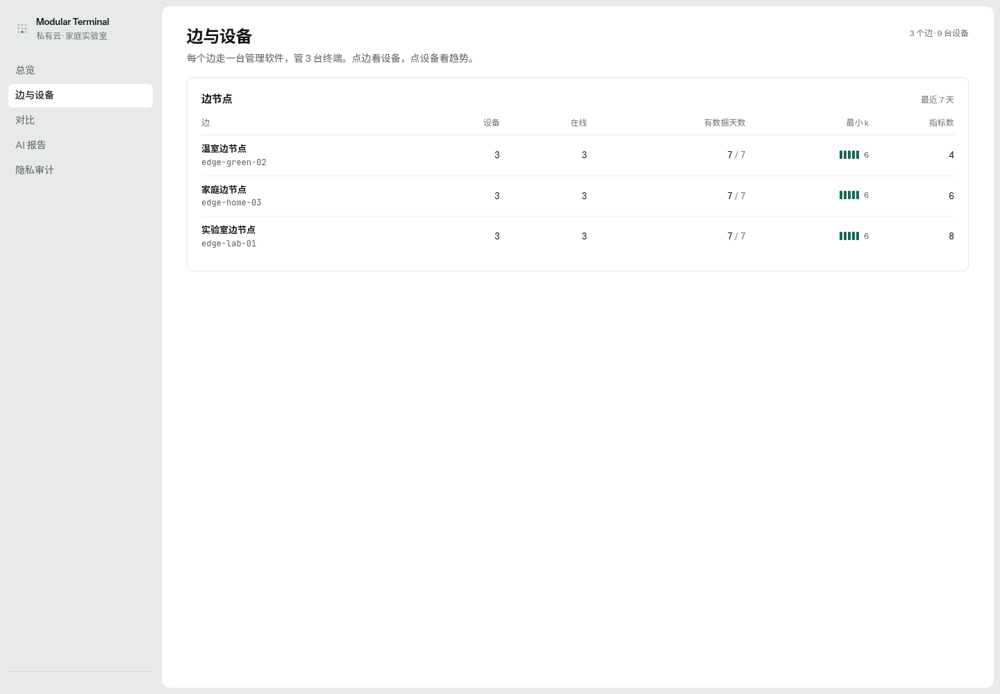
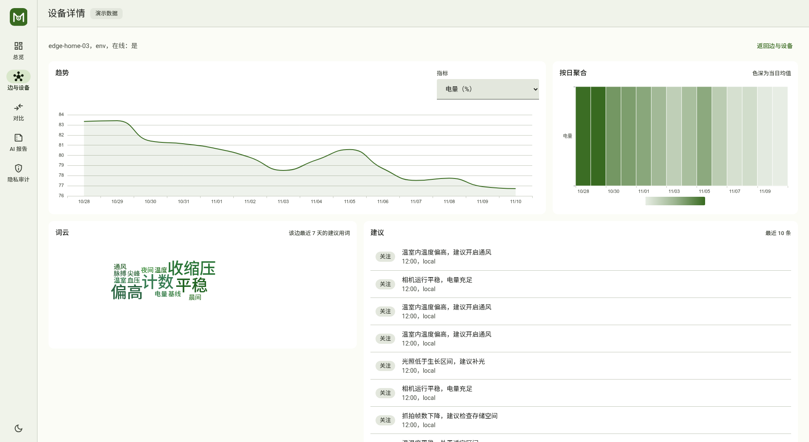
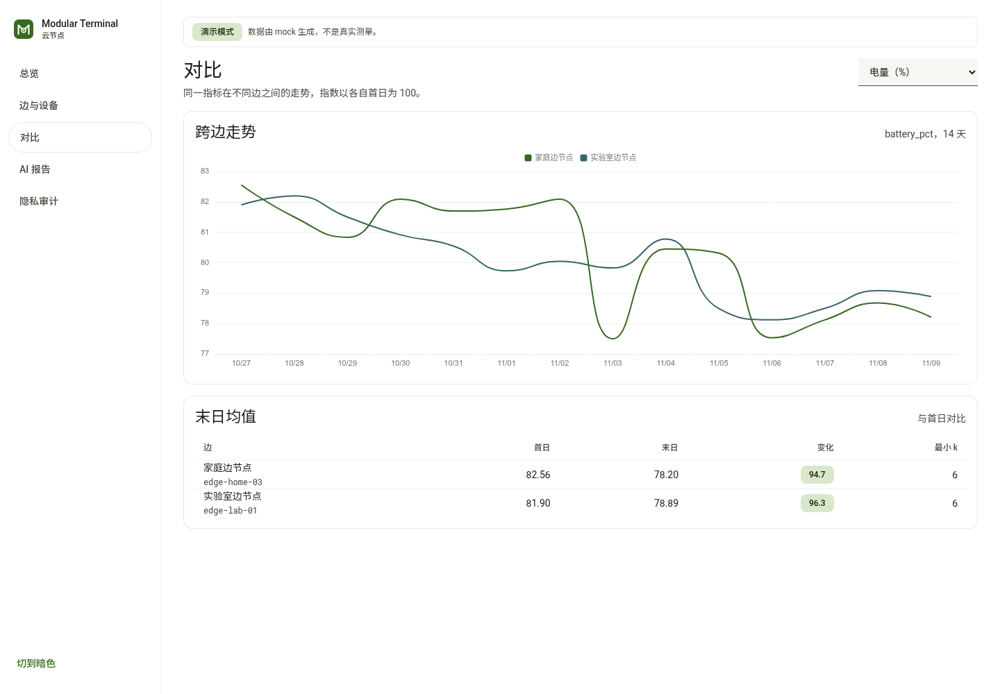
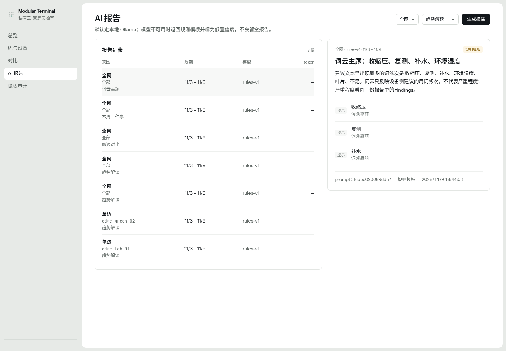
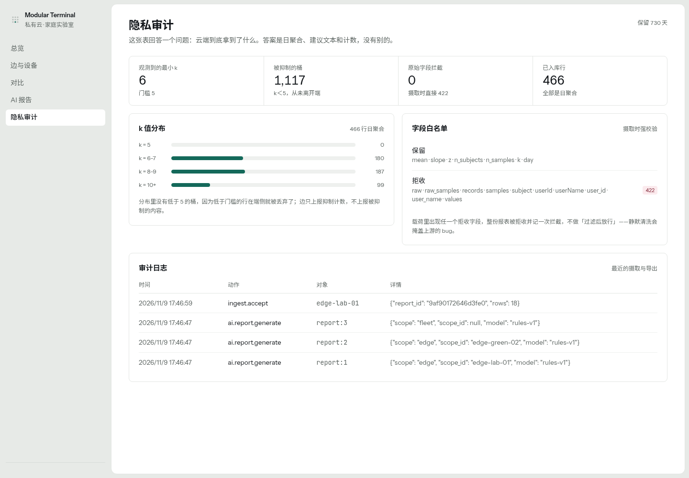

# Modular Terminal Cloud

端-边-云三层里的**云**：一台内网私有云。接收多个边节点上报的**日聚合**，
做跨边对比、AI 解读和隐私审计。方向相反——它不看单个用户，只看群体。

## 界面（1900×1040，亮色）

| 总览 | 边与设备 | 设备详情 |
|---|---|---|
|  |  |  |
| **对比** | **AI 报告** | **隐私审计** |
|  |  |  |

截图是按 1900×1040 截的；页面用 `clamp` 栅格，1920/1440/1366 下总览也是整屏不滚动。

## 边、云两仓的分工

| | 云（本仓） | 边（另一仓） |
|---|---|---|
| 位置 | 内网私有云 | 局域网内一台管理节点 |
| 面向对象 | 多个边节点，每个边下面若干台设备 | 3 台终端（1 台带屏 + 2 台无头） |
| 数据粒度 | 日聚合，没有逐条记录 | 5 分钟窗口的假名聚合 |
| 身份 | 管理员口令 + TOTP，会话是签名 cookie | 设备证书 + 配对码，MQTT 走 mTLS |
| 存储 | Postgres 16 + Redis 7 | SQLite，设 `EDGE_DB_KEY` 走 SQLCipher |
| 队列 | RQ 跑三类文档任务；清理、备份、恢复演练由 worker 的排期线程触发 | 无队列，发件箱表 + 退避重试 |
| 分析 | 跨边对比、AI 解读、隐私审计 | 趋势、7×24 时段矩阵、词云、窗口级 z 异常 |
| 告警 | 日聚合；2 小时没有上报算边掉线 | 5 分钟窗口；15 分钟没有批次算数据过期 |
| 入口 | 443 管理台、8443 mTLS 收报、8088 本机明文 | 8001，默认只绑 127.0.0.1 |
| 备份 | 每天 `pg_dump` 留 14 天，周日加密副本，每月恢复演练 | 每天一份 SQLite 快照，留 7 份 |
| 保留期 | 日聚合 730 天、文本 365 天 | 聚合 180 天、文本 365 天 |
| 架构文档 | §6 云端 | §5 边缘节点 |

两边共用一份 `orpi.edge.report.v1` 契约：**边仓拥有它**，云仓 vendor 一份副本，
`scripts/sync_contracts.py --check` 两边都跑。改字段的顺序是先改边仓、再同步云仓，
反过来会漂移。

架构文档 v2.3 里 §5 写边、§6 写云，所以两个仓的「逐条对照」表条目不同，
写法一样：一条对应一个编号，写清要求、现状和怎么验。两边都如实标出没做的部分，
不把「驱动已内置但默认没开」写成「已支持」。

## 每个页面回答一个问题

前端与边仓同一套：Vue 3 + Vite + ECharts，自写 Material 3 token，亮色默认，侧栏左下角可切暗色；ECharts 与拓扑缩略图跟随换主题。

| 页面 | 它回答的问题 | 关键内容 |
|---|---|---|
| 总览 | 现在有没有事，先处理哪一条？ | 首屏 6 块图：全网拓扑（带边名、设备悬停、可缩放）、近 7 天完整率、各边每日入库、指标覆盖、边在线率、告警 Top5；右栏待处理（确认/静音）与本周报告摘要 |
| 边与设备 | 问题出在哪个边、哪台设备？ | 两级下钻：点边筛设备，点设备进详情（趋势/日热力/词云/建议流） |
| 对比 | 谁跑得不一样？ | 同指标跨边指数（首日 = 100）、末日指数与变化 |
| AI 报告 | 机器怎么看这一周？ | 报告列表、findings、动作、模型与 token；可按原区间重新生成 |
| 隐私审计 | 云到底拿到了什么？ | k 值分布、被抑制桶数、原始字段拦截、字段白名单、审计日志 |

## 快速开始

```bash
python3 -m pip install -r requirements.txt
# 先起 Postgres 16 与 Redis 7（可以用 compose 只起这两个）
docker compose -f docker/compose.yml up -d postgres redis
./run.sh                       # 首次自动写入 3 个边 × 3 台设备 × 14 天演示数据
# http://127.0.0.1:8002
```

前端（Vue 3 + Vite + ECharts，手写 Material 3 token）：

```bash
cd web && npm install && npm run dev     # http://127.0.0.1:5173，/api 代理到 https://localhost
```

整套（caddy + web + api + worker + postgres + redis + ollama）：

```bash
cd docker && docker compose up -d --build
docker compose ps              # api / worker / postgres / redis 全部 healthy

# 要跑本地模型时按卡型加一个覆盖文件（默认不起 ollama）
docker compose -f compose.yml -f compose.nvidia.yml --profile ai up -d   # NVIDIA/CUDA
docker compose -f compose.yml -f compose.amd.yml    --profile ai up -d   # AMD/ROCm
```

单测用 `pip install -r requirements-dev.txt` 后直接 `python3 -m unittest discover -s tests -t .`：
`pgserver` 会拉起一个临时 Postgres，不需要 sudo 或 docker；`CLOUD_QUEUE_SYNC=1` 让任务就地执行。

需要登录时（多机部署务必开）：

```bash
export CLOUD_ADMIN_PASSWORD='换成你的口令'
export CLOUD_ADMIN_TOTP='用 python3 -c "from cloud import auth;print(auth.secret_hint())" 生成'
```

## 数据流

```
边节点 ── POST /api/v1/ingest/edge-report ──▶ 云
              │  出现 user_id / subject / values 直接 422
              │  telemetry_daily 里任何一行 k<5 整份拒收
              ▼
        telemetry_daily   日聚合，唯一事实来源
        advice            建议文本
        word_freq         jieba 词频
        ai_reports        AI 解读（同输入 24 h 内复用）
        audit             每次摄取、登录与导出留痕
        alert_state       人工动作（确认/静音），告警本身由 telemetry_daily 现算
```

幂等键 `(edge_id, report_id)`；重复投递返回 `duplicate: true` 且不写库。

**指标字典来自数据，不是常量。** 边在日聚合里带上 `module_id / label / unit / table`，
云把它们一起入库；`/api/v1/meta` 由 `SELECT DISTINCT metric` 生成，
所以换模块之后前端下拉框、AI 措辞、对比页都会自动多出新指标。

## 已实现的功能

| 能力 | 说明 | 验证方式 |
|---|---|---|
| 摄取与幂等 | 原始字段 422、k<5 整份拒收、重复投递不写库 | `tests/test_ingest.py` |
| 管理员登录 | 口令 + TOTP（RFC 6238）+ HMAC 会话 cookie | `tests/test_auth.py`，含 RFC 测试向量 |
| AI 模式 B（默认） | 本地 Ollama，模型 `qwen3.5:9b`；不可用退回规则模板 | `tests/test_ai.py` |
| AI 模式 A | 公有 API（`qwen3.5`），只发 k≥5 聚合，月度 token 预算熔断 | `tests/test_ai_public.py`，用本地假 API |
| 报告缓存 | 同 scope + 周期 + 输入摘要 24 h 内复用 | `tests/test_ai.py` |
| 词云 | jieba 分词 + 停用词 | `cloud/ai.py`、线上页面 |
| 动态指标字典 | 标签/单位跟着上报走，不写死 | `/api/v1/meta` |
| 保留期清理 | L2 日聚合 2 年、L3 文本（建议/词频/报告）1 年，按天删 | `cloud/jobs.py` |
| 每日全网报告 | 24 h 没有新报告就补一份 | 同上 |
| 隐私审计 | k 分布、抑制计数、拦截计数、字段白名单、导出留痕 | `tests/test_ingest.py` |
| 告警状态机 | 日聚合 z 推出的告警，确认、静音、取消静音都写审计 | `tests/test_alerts.py` |
| 公网最小暴露 | 8443（边→云 mTLS 口）只放行 `/ingest/edge-report` 与 `/health`，其余 403；`/ollama/*` 只在内网站点 | `docker/Caddyfile`，实测见 `scripts/verify_exposure.sh` |
| mDNS 广播 | 云广播 `_orpi-cloud._tcp`（v/id/port/ca_fp），边据此发现云 | `cloud/mdns.py`，容器内实测 `on: true` |
| 演示模式 | `demo` 与构建号随 `/health` 暴露，侧栏底部标注「演示数据」；seed 写审计 | `cloud/seed.py`、`cloud/api.py` |

### 最近补的

- **群体分析开关真的传到云**：`edge-report.v1` 的 `privacy` 带 `group_analysis`，云按边存进 `edges` 表；关掉的边，日聚合、建议、词频、告警、对比、AI 摘要都不再参与查询，总览只保留在线/健康计数并标出是哪条边关的。
- **对比页支持多设备**：`GET /compare?metric=&scope=devices`，前端可切「按边 / 按设备」，都按首日归一为 100。
- **GPU 不锁厂商**：`/health` 同时识别 NVIDIA 与 AMD；`docker/compose.nvidia.yml` / `docker/compose.amd.yml` 两个覆盖文件分别接 CUDA 与 ROCm，AMD 卡不在支持列表时可设 `HSA_OVERRIDE_GFX_VERSION`。
- **模型自检**：`/health` 的 `model` 会报 Ollama 里的 digest；设 `CLOUD_OLLAMA_SHA256` 就比对，不一致可直接看出来。Ollama 请求补了 `think:false` 与 `num_predict:1000`。
- **公网边界有自检了**：`scripts/verify_exposure.sh` 拿 cloud-ca 签的边证书连 8443，逐条验证「两条路由通、其余 403、不带客户端证书连不上」，
  顺带反证 443 的内网管理 API 没被一起挡住。改 Caddyfile 之后跑一次就知道有没有多开。
- **公网两条路由限速**：`ingest` 60 次/分、`health` 120 次/分，按客户端 IP，超了 429。
- **管理员登录锁定**：10 分钟内错 5 次锁 10 分钟，锁定期间也回 429，写入 `auth.login` 审计。
- **总览重做**：首屏 6 块图（带边名的全网拓扑、近 7 天完整率、各边每日入库、指标覆盖、边在线率、告警 Top5）+ 右栏待处理与摘要；拓扑可缩放、设备悬停出名字。
- **报告列表去重**：同 `(scope, scope_id, 周期, 任务)` 只返回最新一份。
- **演示心跳**：没有真实上报的边由 `jobs.demo_heartbeat()` 每 15 分钟补一条收件记录，只动 `last_seen` 与 `reports`。
- **边关掉群体分析后，这里只收到在线/健康计数**：边侧挡在 `/overview` 与词云，云不替它补，也不会凭空出现分设备走势。
- **截图重截**：`docs/screenshots/` 是 1900×1040 的新版，README 里六页并排。


## 告警怎么判定、怎么关掉

一条告警不是「一天越界」，而是**一段连续越界的日子**：一段只算一条。
不合并的话，一次持续一周的偏移会刷出七条，列表就没法看了。

| 级别 | 判定 |
|---|---|
| 严重 | 段内有两个相邻日子的 `\|z\| ≥ 2.5`；或某个边 2 小时没有上报 |
| 注意 | 单日 `\|z\| ≥ 2`，但没到严重的程度 |

人工只有两个动作，恢复是自动的：

| 状态 | 怎么进来 | 效果 |
|---|---|---|
| 待处理 | 新的一段越界日 | 进首屏「待处理」，按严重度排序 |
| 已确认 | 点「确认」 | 留在列表里，视觉降级，不再计入首屏结论 |
| 已静音 | 点「静音」，选 1h / 8h / 24h / 7d 并填理由 | 条目变灰，显示理由与到期时间，可取消静音 |
| 已恢复 | 后续日子回到 `\|z\| < 2` | 读取时自动推出，不需要人工关 |

确认、静音、取消静音都写 `audit`：谁、什么时候、对哪一条、理由是什么。
静音不带理由会被 422 挡掉——审计里写不出「为什么」的静音等于没写。

## 隐私边界

云端**没有**原始记录，也没有假名 subject：

| 云端有 | 云端没有 |
|---|---|
| 日聚合 `mean / slope / z / n_samples / k` | 逐条读数 |
| 建议文本 | 用户名、用户 ID |
| 抑制计数（只有数量） | 被抑制的内容 |
| 词频 | 设备序列号、地理位置 |

`k < 5` 的行在端侧已经不产生，边也不会转发；云侧再校验一次，出现即整份拒收。

## API

完整定义见 [`contracts/openapi/cloud.yaml`](contracts/openapi/cloud.yaml)，运行时 Swagger 在 `/api/docs`。

公网只应暴露两条：`/api/v1/ingest/edge-report` 与 `/api/v1/health`。
管理台与 Ollama 仅内网——`docker/Caddyfile` 就是这么配的，其余路径在 8443 上直接 403。

**公网入口是 8443**（要求 cloud-ca 签发的客户端证书）。443 是内网管理台和前端，别映射到公网。
`scripts/verify_exposure.sh` 用 `docker/certs/` 里 cloud-ca 签的边证书逐条实测：

```
[PASS] 健康检查可达（200）        [PASS] 上报路由可达，交给 api 判令牌与载荷（422）
[PASS] /api/v1/overview 被挡（403） [PASS] /api/v1/edges 被挡（403）
[PASS] /api/v1/privacy/audit 被挡（403） … [PASS] 不带客户端证书连不上（要求 mTLS）
[PASS] 内网入口的管理 API 照旧（200）
```

这两条按客户端 IP 限速（收报 60 次/分、健康检查 120 次/分），超了回 429；
管理员登录 10 分钟内错 5 次锁定 10 分钟，锁定期间同样回 429。

告警相关：

| 方法 | 路径 | 用途 |
|---|---|---|
| GET | `/api/v1/alerts` | 待处理 / 已确认 / 已静音的告警（一段连续越界日一条） |
| POST | `/api/v1/alerts/ack` | 确认一条，body 是 `{"key": "..."}` |
| POST | `/api/v1/alerts/mute` | 静音一条，必填时长与理由 |
| POST | `/api/v1/alerts/unmute` | 取消静音 |

## 契约

| 契约 | 位置 | 谁拥有 |
|---|---|---|
| `orpi.edge.report.v1`（边→云） | `contracts/vendor/edge/edge-report@v1.json` | 边仓，本仓 vendor |
| `ai.report.v1`（云内） | `contracts/ai/report.v1.json` | **本仓** |

## 测试

```bash
python3 -m unittest discover -s tests -t . -v
```

**38 个用例**：摄取边界（含 `privacy.personalization` / `group_analysis`）、多边与多设备对比、GPU 厂商识别、审计口径、AI 契约与缓存、TOTP 与会话、
公有 API 的成功/失败/超额三条路径、本地 Ollama 契约与不可达兜底、显式 period、建议文本按不可信数据加分隔、
告警按日聚合的合并与确认/静音/审计。

## 与架构文档 v2.3 的逐条对照

| 文档条目 | 要求 | 现状 |
|---|---|---|
| §6.1 部署 | Caddy + Postgres + Redis + RQ + Ollama、mDNS、资源限额 | ✅ 七个服务；PG 16、Redis 7 + RQ、worker 跑三类任务；内存限额 PG 2G/Redis 1G/API 1G/worker 1G/Ollama 8G；云广播 `_orpi-cloud._tcp`，`/ollama/*` 仅内网 |
| §6.2 数据模型 | edges/devices/telemetry_daily/advice/ai_reports/word_freq/audit | ✅ 七张表齐全，另加 reports（幂等收件箱）与 alert_state（人工动作） |
| §6.3 AI 分析 | 模式 A/B、四种任务、强制 JSON、失败重试 2 次后落模板、建议文本按不可信数据处理 | ✅ 四种任务都有规则实现；首次 + 重试 2 次仍不过契约就退回 `rules-v1`；建议文本去控制字符、截断并用「」分隔，prompt 明确它是数据不是指令 |
| §6.4 网站 | 五页、两级下钻、多边/多设备对比 | ✅ 五页齐全；边与设备支持 `边 → 设备详情`；对比页可切「按边 / 按设备」，都按首日归一为 100；Vue3 + Vite + ECharts，自写 M3 token |
| §6.5 API | ingest、overview、edges、devices、series、heatmap、wordcloud、ai/reports、privacy/audit | ✅ 全部实现；`POST /ai/reports` 支持 scope/period/mode/task，另加 meta/compare/daily/auth/alerts |
| §6.6 成本控制 | 24 h 缓存、单次 ≤8k token、输出 ≤1k | ✅ 缓存按「输入摘要 + 任务」；输入超 8k 自动裁剪；`max_tokens=800` |
| §6.7 备份 | 每日 pg_dump 保留 14 天 | ✅ worker 每天 03:00 跑 `pg_dump`（自定义格式 + `pg_restore --list` 校验），保留 14 天；周日另做 gpg AES256 加密副本；每月恢复演练（临时库导入 + 行数比对 + 记 RTO） |
| §6.8 GPU 降级 | CUDA 不可用切规则模板 | ✅ `/health` 自检 NVIDIA（nvidia-smi/CUDA）与 AMD（rocm-smi/ROCm）；两者都没有时模型不可用 → 规则模板，不会留空报告 |

## 仍然没做的

| 方案里的东西 | 现状 |
|---|---|
| GPU（NVIDIA / AMD） | 本机没有可用的推理卡。模型已定 `qwen3.5:9b`（5.6 GB），但没有拉取也没有跑过：CPU 16 核跑 9B 达不到 §6.8 的 p95 ≤30 s，等卡到位再测。NVIDIA 用 `compose.nvidia.yml`，AMD 用 `compose.amd.yml`（ROCm）；本地模型路径目前只用桩服务验了请求与 JSON 契约 |
| 备份落外接 USB 盘 | 路径可配（`CLOUD_BACKUP_HOST_DIR`）；已用独立目录模拟外接盘跑通备份与恢复演练，插真盘只改环境变量 |
| 每周副本的异地存放 | 加密副本已做（gpg AES256），但"拷到另一块盘"属于运维动作，代码只负责生成 |
| 多租户 | 明确不做（方案里也不在范围） |
| 本地模型未跑 | 已定 `qwen3.5:9b`，镜像与模型都没拉；p95 与输出质量等 GPU |
| 性能基线 | 本机 `/overview` p95 200 ms、`pg_dump` 0.3 s；目标机 72 h 未测 |
| Postgres 卷静态加密 | 需要宿主机 LUKS（或加密块设备）；代码只保证备份用 gpg AES256。部署时把 `pgdata` 落到已加密的挂载点 |

演示数据由 `cloud/seed.py` 生成，**不是真实上报**；接真机前清掉 `data/`。

端侧（另一个仓）还缺 §3 的 data_schema / DB API v3、§4 的 HyperVisor 聚合与上报、
§5.10 的 headless、§8 的 device_salt 与 L1-out；云这边收得到契约，但真实终端还发不出来。

演示模式下，另外两个边由 `cloud/jobs.demo_heartbeat()` 每 15 分钟补一次收件记录，
只更新 `last_seen` 与 `reports`，不改日聚合、不伪造告警。接真机时把 `CLOUD_DEMO=0` 关掉。

## 本机还能补的，和只能等硬件的

| 项 | 本机能否完成 | 现状 |
|---|---|---|
| 逐设备 MQTT ACL | ✅ 已完成（在边仓） | `scripts/verify_acl.sh`：边 CA 现签证书连 8883，自己前缀能发能收，别人前缀与通配订阅被拒 |
| 性能基线（§11.2 / §11.3） | 能，已测一轮 | 边 `/overview` p95 338 ms、云 `/overview` p95 200 ms、`pg_dump` 0.3 s、各容器内存均低于限额；CPU/72 h 需在目标机复测 |
| 同意开关落地 | ✅ 已完成（在边仓） | 关 `group_analysis` → 边回「样本不足」；关 `personalization` → 报表不带 advice/词频；变更写审计 |
| 公网边界自检 | ✅ 已完成 | `scripts/verify_exposure.sh`：8443 只通两条路由，其余 403，无客户端证书连不上；443 内网照旧 |
| 本地 9B 模型 | 不能 | 无 NVIDIA 显卡，模型 5.6 GB，等 GPU |
| 双网 30 s / 10 用户轮换 / 72 h | 不能 | 需要三台终端 |
| 端侧 §3 / §4 | 不在本仓 | 已分发给端仓 |
| 备份异地 | 不能 | 需要第二块盘 |

## 目录

```
cloud/         API、存储、AI、鉴权、调度、备份
web/           Vue 3 + Vite 前端：M3 token、ECharts、拓扑缩略图
contracts/     ai 契约、示例、OpenAPI、vendor 副本
tests/         摄取 / AI / 鉴权 / 告警
docker/        compose、Caddyfile
scripts/       vendor 契约同步、备份
docs/          截图
data/          运行期数据，不进仓库
```
